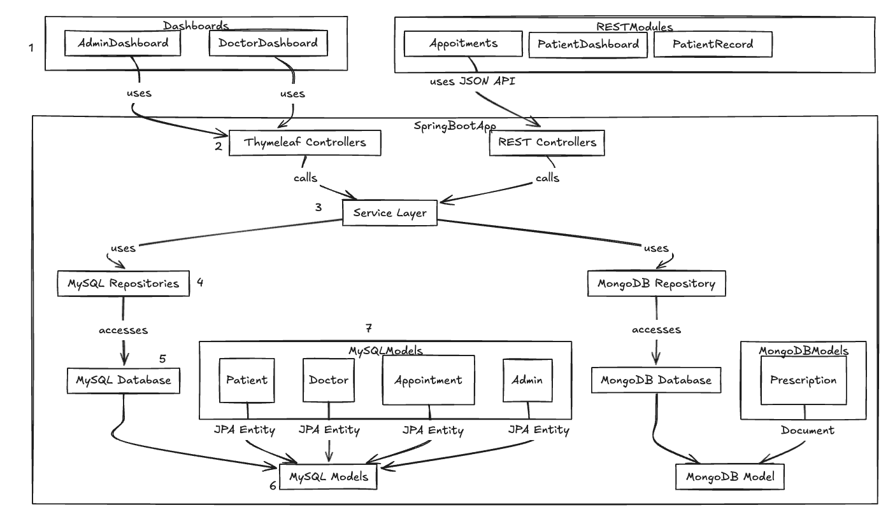

# Smart Clinic Management System
### IBM Coursera Java Development Capstone Project

[](https://www.oracle.com/java/)
[](https://spring.io/projects/spring-boot)
[-6DB33F?style=flat&logo=springsecurity&logoColor=white)](https://spring.io/projects/spring-security)
[](https://www.thymeleaf.org/)
[](https://www.mysql.com/)
[](https://www.mongodb.com/)
[](https://www.docker.com/)

> Full-stack outpatient healthcare management application developed as the capstone project for the **IBM Java Development Professional Certificate** on Coursera.

---

## 📌 1. Project Scenario & Business Context

**SmartCare Solutions** is a digital health platform transforming outpatient clinic operations. Small and medium-sized clinics often encounter operational bottlenecks due to reliance on manual paperwork, physical registers, and disconnected spreadsheets. These outdated mechanisms cause scheduling collisions, prolonged patient wait times, fragmented health histories, and administrative delays.

The **Smart Clinic Management System** addresses these challenges by delivering an intuitive, secure, and cloud-ready portal that empowers clinic administrators, doctors, and patients to seamlessly manage appointments, medical records, and daily schedules.

---

## 🏛️ 2. Three-Tier Web Architecture Overview

The system is designed as a robust **three-tier web application** built on the **Spring Boot** framework, ensuring clean separation of concerns, maintainability, and scalability:

```
┌────────────────────────────────────────────────────────────────────────┐
│                        THREE-TIER ARCHITECTURE                         │
├────────────────────────────────────────────────────────────────────────┤
│ 1. PRESENTATION TIER                                                   │
│    • Thymeleaf Dashboards: AdminDashboard, DoctorDashboard (SSR HTML) │
│    • REST Modules: Appointments, PatientDashboard, PatientRecord (SPA) │
├────────────────────────────────────────────────────────────────────────┤
│ 2. APPLICATION TIER (Spring Boot 3.4.4 Backend)                        │
│    • Controllers: Thymeleaf View Controllers & REST API Controllers   │
│    • Service Layer: Business logic, validation, workflow coordination  │
│    • Security: JJWT token generation, validation, and role enforcement │
├────────────────────────────────────────────────────────────────────────┤
│ 3. DATA TIER (Polyglot Persistence)                                    │
│    • MySQL 8.0: Normalized relational store (Patients, Doctors, Admins,│
│                 Appointments) via Spring Data JPA & Stored Procedures  │
│    • MongoDB 7.0: Flexible document store (Prescriptions, Dosages)    │
│                   via Spring Data MongoDB                              │
└────────────────────────────────────────────────────────────────────────┘
```

### Why Spring Boot and Polyglot Persistence?
- **Spring MVC & REST Support**: Combines server-rendered Thymeleaf HTML for administrative dashboards with JSON-based REST APIs for decoupled patient modules.
- **Relational MySQL (ACID)**: Enforces strict foreign-key integrity and transactional concurrency to eliminate appointment double-booking.
- **Document MongoDB (NoSQL)**: Prescriptions and clinical notes feature variable, multi-item arrays of medicines and instructions that benefit from a schema-flexible document store without costly schema migrations.

---

## 🖼️ 3. Architecture Diagram



---

## 🔄 4. Numbered Flow of Data and Control (Steps 1 to 7)

Based directly on the architecture diagram, the application processes requests through seven coordinated steps:

1. **User Interaction at Presentation Layer**: Users access the platform through either server-rendered browser views (`AdminDashboard`, `DoctorDashboard`) or via client-side REST modules (`Appointments`, `PatientDashboard`, `PatientRecord`).
2. **Request Routing to Controllers**: User requests are received by the Spring Boot backend and routed by URL path and HTTP method to either a **Thymeleaf Controller** (for HTML views) or a **REST Controller** (for JSON API endpoints).
3. **Business Logic Execution (Service Layer)**: The controllers delegate incoming requests to the **Service Layer**, which coordinates workflows, validates parameters, and executes clinical rules (e.g., verifying doctor availability before booking).
4. **Data Access via Repositories**: The service layer communicates with Spring Data repositories—using **MySQL Repositories** (Spring Data JPA) for structured relational data and the **MongoDB Repository** (Spring Data MongoDB) for document data.
5. **Database Access & Execution**: The repositories query the underlying database engines: **MySQL** handles relational queries with ACID guarantees and foreign-key constraints (for patients, doctors, admins, and appointments), while **MongoDB** executes document reads and writes (for dynamic prescription records).
6. **Model Binding**: Retrieved database records are converted into strongly typed Java domain models—mapped into JPA Entities (`@Entity`) for MySQL table rows, and into Document objects (`@Document`) for MongoDB BSON/JSON collections.
7. **Response Delivery (Application Models in Use)**: The bound models or transformed DTOs are returned up the chain to generate the final response: Thymeleaf controllers bind the models to HTML templates to render dynamic web pages, while REST controllers serialize the data into JSON payloads returned to the client.

---

## 📋 5. Capstone Modules & Roadmap

| Module | Title | Status | Core Tasks & Deliverables |
| :--- | :--- | :---: | :--- |
| **Module 1** | **Project Overview & Requirements Gathering** | ✅ Completed | Architecture Specification, Three-Tier Design Walkthrough, Agile User Stories. |
| **Module 2** | **Database Designs & JPA Models** | ⏳ In Progress | MySQL relational schemas, MongoDB document schemas, JPA Entities with Bean Validations (`@Valid`, `@NotNull`). |
| **Module 3** | **Sample Data & Stored Procedures** | 📋 Next Up | SQL/NoSQL seed data insertion, MySQL Stored Procedures for daily clinic analytics & doctor workload. |
| **Module 4** | **Frontend and MVC Architecture** | 📋 Planned | Dynamic Thymeleaf templates, client-side JS utilities, MVC controllers, and secure JWT authentication. |
| **Module 5** | **Containerization and Deployment** | 📋 Planned | RESTful API endpoints, multi-stage Dockerfiles, Docker Compose, and GitHub Actions CI pipelines. |
| **Module 6** | **Final Submission & Evaluation** | 📋 Planned | GitHub repository review, working deployment artifacts, and course wrap-up. |

---

## 📂 6. Repository Layout

```
java-database-capstone/
├── .github/
│   └── workflows/              # GitHub Actions CI automation
├── img/
│   └── archr_dig/
│       └── simplified-architecture-diagram.png  # Architecture Diagram
├── schema-architecture.md      # Architecture specification document
├── README.md                   # Project overview & documentation (This file)
│
└── app/                        # Spring Boot Application Root
    ├── pom.xml                 # Maven dependencies & build configuration
    ├── mvnw / mvnw.cmd         # Maven wrapper scripts
    └── src/
        ├── main/
        │   ├── java/com/project/back_end/
        │   │   ├── BackEndApplication.java   # Spring Boot Entry Point
        │   │   ├── config/                   # WebMvc & CORS Configuration
        │   │   ├── controllers/              # RESTful API Controllers
        │   │   ├── DTO/                      # Request / Response Data Transfer Objects
        │   │   ├── models/                   # JPA Entities & Mongo Documents
        │   │   ├── mvc/                      # Thymeleaf MVC View Controllers
        │   │   ├── repo/                     # Spring Data JPA & Mongo Repositories
        │   │   └── services/                 # Clinical Domain Business Logic & JWT Services
        │   │
        │   └── resources/
        │       ├── application.properties    # Database & server configuration
        │       ├── templates/                # Server-rendered Thymeleaf HTML
        │       │   ├── admin/adminDashboard.html
        │       │   └── doctor/doctorDashboard.html
        │       └── static/                   # CSS, Logo, and Client JS modules
        │           ├── pages/                # Patient portal & booking HTML views
        │           └── js/                   # Components, services, and API fetch utilities
        │
        └── test/                             # Automated Unit & Integration Tests
```

---

## 🛠️ 7. Tech Stack & Environment Prerequisites

* **Language**: Java 17 / 21 LTS
* **Framework**: Spring Boot 3.4.4
* **ORM & Data**: Spring Data JPA (Hibernate), Spring Data MongoDB
* **Security & Tokens**: JJWT 0.12.6 (`jjwt-api`, `jjwt-impl`, `jjwt-jackson`), Spring Boot Starter Validation
* **Databases**:
  * **MySQL 8.0**: Port `3306` (Database: `clinic_db`)
  * **MongoDB 7.0**: Port `27017` (Database: `clinic_nosql`)
* **Build Tool**: Apache Maven 3.9+ (or included Maven Wrapper `./mvnw`)
* **DevOps**: Docker & GitHub Actions

---

## 🚀 8. Build & Run Instructions

### 1. Configure Database Connections
Ensure MySQL and MongoDB are running, then verify credentials in `app/src/main/resources/application.properties`:
```properties
# MySQL Configuration
spring.datasource.url=jdbc:mysql://localhost:3306/clinic_db?createDatabaseIfNotExist=true
spring.datasource.username=root
spring.datasource.password=your_password
spring.jpa.hibernate.ddl-auto=update

# MongoDB Configuration
spring.data.mongodb.uri=mongodb://localhost:27017/clinic_nosql
```

### 2. Build the Application
Navigate to the `app` directory and build with Maven:
```bash
cd app
./mvnw clean install
```
*(On Windows PowerShell, use `.\mvnw.cmd clean install`)*

### 3. Run the Backend
```bash
./mvnw spring-boot:run
```

Once started, access the application in your browser:
* **Admin Dashboard**: `http://localhost:8080/admin/dashboard`
* **Doctor Dashboard**: `http://localhost:8080/doctor/dashboard`
* **Patient Portal**: `http://localhost:8080/pages/patientDashboard.html`